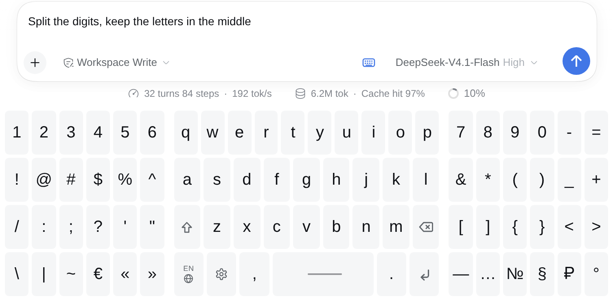
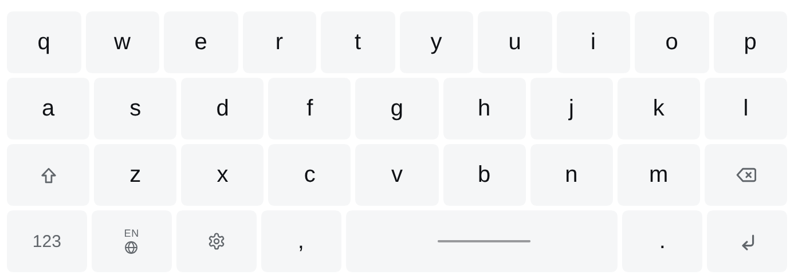
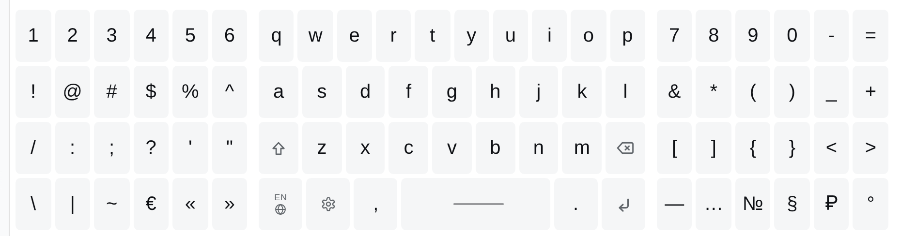
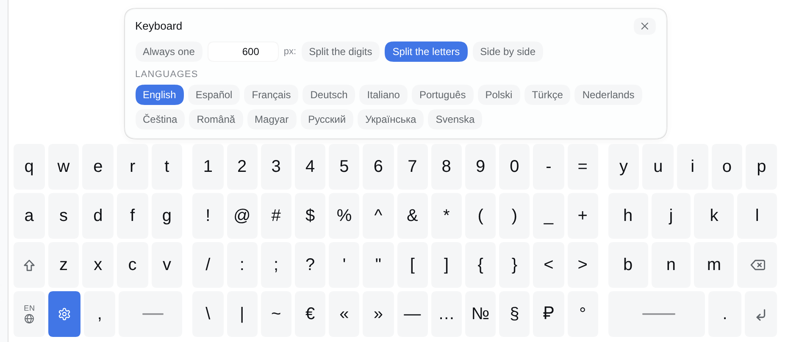
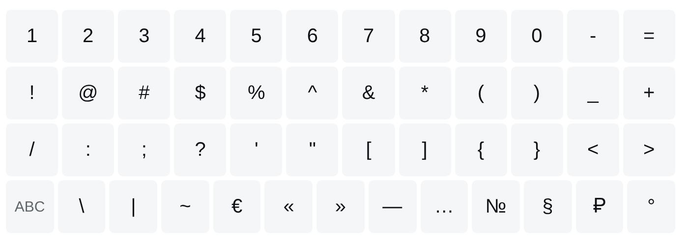
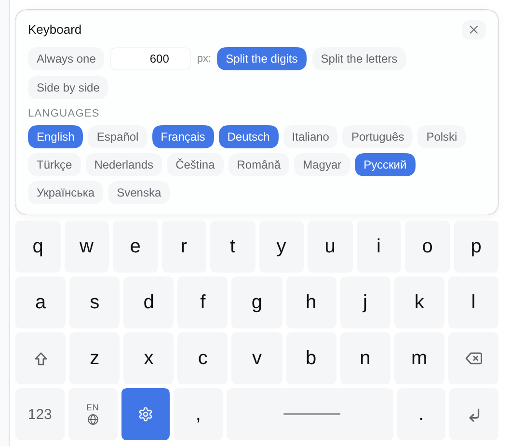

# doublekeys

**An on-screen keyboard for the DeepSeek Harness web composer** — a full keyboard that lives inside the chat
panel, built for phones and tablets. No predictions, no autocorrection, no T9, no automatic capitalisation:
what you tap is what you get, and Shift is a manual sticky key.

[](LICENSE)




## Why

On a phone the system keyboard covers half the screen and keeps fighting the page: autocorrect rewrites words,
autocapitalisation turns `i` into `I`, and the composer loses the caret every other tap. `doublekeys` is a
plugin-side keyboard: it renders its own keys, types into the composer through the conversation plugin's
public editing API and suppresses the system keyboard while it is open.

It is also built for wide screens: on a tablet the keyboard can split into two halves with the digits on the
sides, so both thumbs stay on the edges.

## Features

- **Four arrangements.** One keyboard with pages, digits split to the edges, letters split to the edges, or
  digits and letters side by side. Three of them adapt to the composer width; the fourth never duplicates.
- **15 layouts**, all in the standard four-row shape of a physical keyboard (three letter rows plus the control
  row), with the national letters of each language sitting on the keyboard as real keys.
- **No assistive typing.** No predictions, no completions, no autocapitalisation, no autocorrect, no T9. The
  inserted character is exactly the character that was tapped.
- **Manual Shift.** Sticky until a letter is typed; the state is visible on the key.
- **Repeat on hold.** Letters, space and Backspace repeat while held (first repeat after 420 ms, then every
  70 ms), so `aaaa` or a long delete take one gesture.
- **Real line breaks.** The &#8629; key inserts a newline into the draft, the composer grows, the message keeps
  the break.
- **Word selection stays usable.** Double click, double tap and long press select the word under the finger;
  the next key replaces it.
- **Nothing to configure to start.** English and one keyboard by default; everything else is in the gear.

## Install

`doublekeys` is a regular DSH client-plugin bundle: a `package.json` with a `dsh.client` block and a plain
browser module, no build step.

**Through the in-app Plugin Manager** (recommended): install the bundle from this directory, for example with
`plugin_manager` → `install_bundle` and the path to the clone. That adds the dependency to the profile and puts
`doublekeys` into `dsh.profile.bundles`, so the web client picks it up.

**By hand**, in a profile:

```bash
cd ~/.dsh/profiles/web
pnpm add /path/to/doublekeys          # or: npm link /path/to/doublekeys
```

then add the bundle name to the profile `package.json`:

```json
{
  "dsh": {
    "profile": {
      "bundles": ["@deepseek-ai/dsh-base", "@deepseek-ai/dsh-web-app", "doublekeys"]
    }
  }
}
```

Reload the panel (or restart `dsh web`). The keyboard toggle appears in the composer's tools row.

## Using it



- The **keyboard button** in the composer toolbar shows and hides the surface.
- **Globe** — switches to the next enabled layout (with a single layout it opens the settings instead). The
  small code above it is the current language.
- **Gear** — settings: arrangements, split width and the language set.
- **Shift** is sticky: tap it, then a letter. **123** opens the digits-and-symbols page when the arrangement
  has no second block.
- The bottom row never squeezes its buttons: the space bar gives up width so every control key stays at least
  as wide as a letter key.

## Layouts

| Arrangement | What you get |
|---|---|
| **Always one** | one keyboard with two pages: letters, and digits + symbols. Never duplicates, ignores the width |
| **Split the digits** *(default)* | three blocks: the two halves of the numeric block on the edges, the letters in the centre |
| **Split the letters** | three blocks: the left half of the letters, the numeric block in the centre, the right half. Shift stays left, Backspace right, and the space bar is on both sides |
| **Side by side** | two blocks: digits on the left, letters on the right |

The three split arrangements obey the **split width** setting (600 px by default, 320–1600): narrower than
that, the panel falls back to one keyboard with pages.





### The numeric block

48 characters in four rows of twelve: the PC number row `1…0 - =`, the same row with Shift
(`! @ # $ % ^ & * ( ) _ +`), then `/ : ; ? ' " [ ] { } < >` and `\ | ~ € « » — … № § ₽ °`. Dot and comma live
on the letters layout, where they are typed far more often.



## Languages

English is on by default; pick more in the settings. Layouts follow the national order of the letters
(QWERTY, AZERTY, QWERTZ, ЙЦУКЕН) and every language stays at four rows — the national letters are real keys,
appended to the spare places of the three letter rows, and whatever does not fit goes to the bottom row next
to the comma (taking width from the space bar). On a phone the rows hold fewer characters and the rest are
reachable from the bottom row.

| Code | Layout | Notes |
|---|---|---|
| `en` | English | QWERTY |
| `es` | Español | `ñ` on the letters, `á é í ó ú ü` as keys |
| `fr` | Français | AZERTY, `é è ê ë à â ç î ï ô ù û ÿ` as keys |
| `de` | Deutsch | QWERTZ, `ä ö ü` on the letters, `ß` as a key |
| `it` | Italiano | `à è é ì ò ù` |
| `pt` | Português | `á à â ã é ê í ó ô õ ú ç` |
| `pl` | Polski | `ą ć ę ł ń ó ś ź ż` |
| `tr` | Türkçe | `ğ ü ş i ö ç`, dotless `ı`; Shift gives `İ` |
| `nl` | Nederlands | `é ë ï ö ü` |
| `cs` | Čeština | QWERTZ, `á č ď é ě í ň ó ř š ť ú ů ý ž` |
| `ro` | Română | `ă â î ș ț` |
| `hu` | Magyar | QWERTZ, `á é í ó ö ő ú ü ű` |
| `ru` | Русский | ЙЦУКЕН |
| `uk` | Українська | ЙЦУКЕН with `і ї є ґ` |
| `sv` | Svenska | `å ä ö` on the letters, `é ü` as keys |

## Settings

The settings panel is one row plus the language set:



- **Always one** · split-width field · `px:` · **Split the digits** · **Split the letters** · **Side by side**
- The **split width** field accepts 320–1600 px and applies on blur or Enter.
- Language chips: any subset of the 15; the globe cycles through the enabled ones.

## Design notes

- **Typing goes through the public API.** The composer is a Lexical editor, not a textarea. The plugin takes
  the slot's `inputActions` face, calls `captureInsertion()` and `insertText()`. Backspace is the same call with
  an empty string over the previous character; the line-break key inserts `\n`, which the composer renders as a
  real line. Sending stays the composer's own button — the keyboard never sends a message.
- **The system keyboard is suppressed, and there is a way out.** While the surface is open the composer root
  gets `inputmode="none"` and autocomplete hints off. If a device still answers a focus by raising its own
  keyboard (the visual viewport shrinks by more than a quarter within 400 ms), the plugin stops focusing and
  keeps working without the caret — set `doublekeys.noFocus` to `false` in `localStorage` to re-enable it.
- **Carets and words.** Focusing a Lexical editor needs `root.focus()` plus `editor.focus()`. A word is picked
  with `caretRangeFromPoint`; on touch the composer's `click` can arrive after `pointerup`, so the range is
  re-applied after the click too.
- **Width is measured, not assumed.** The available width comes from the composer container through a
  `ResizeObserver`; slot anchors that are `display: contents` are skipped.

## Local storage

| Key | Meaning |
|---|---|
| `doublekeys.open` | is the keyboard visible |
| `doublekeys.lang` | current layout |
| `doublekeys.langs` | enabled layouts (JSON array) |
| `doublekeys.mode` | arrangement |
| `doublekeys.breakWidth` | split width in px |
| `doublekeys.noFocus` | focus disabled after a device fought the plugin |

## Compatibility

- DSH web panel (`@deepseek-ai/dsh-web-app`) with `@deepseek-ai/dsh-client-ui-conversation`, any recent
  version that exposes the `conversation.input.dock` slot.
- Chromium and Firefox, desktop and mobile. The panel is checked at 390, 570, 700, 834, 1280 and 1440 px wide,
  light and dark theme.

## Development

```text
client.js          the whole keyboard: data, rendering, typing, selection, styles (plain ES module, no build)
index.js           host half — intentionally empty
cordis.patch.yml   puts the package into a profile so the client roster sees dsh.client
locale/*.json      strings for the plugin manager and for the keyboard
icon.svg           the plugin icon
```

Editing `client.js` is picked up by the client HMR of a running panel without a restart or a reload. Turn the
feature off without uninstalling it:

```yaml
- id: doublekeys
  disabled: true
```

## License

[MIT](LICENSE) © PublicWWW Team
